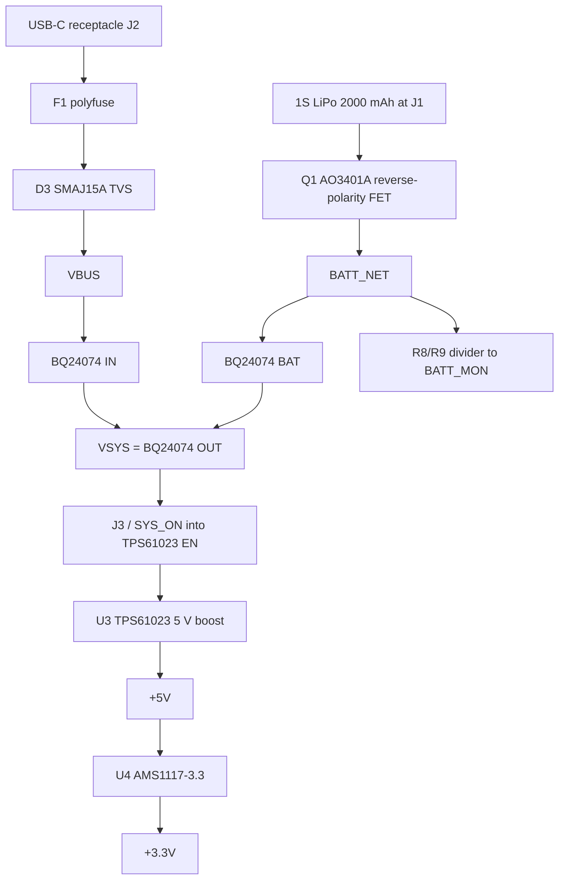

# Debuggy power system

This note explains how power moves through the V1 board: from the USB-C port and the 1S LiPo, through the charger, and out to the `+5V` and `+3.3V` rails. It is written for the team (Jason, Kenneth, Tariq) as a companion to the schematic.

Component-level writeups live in the folders listed at the bottom. Start here for the big picture, then open a folder when you are placing or reviewing that block.

## Block diagram

## How power flows

Two sources can feed the board: USB and the battery. They meet inside the BQ24074, which is a charger **and** a power-path switch, not just a charge IC.

1. **USB-C** presents 5 V after the CC resistors tell the adapter to turn on. That 5 V is fused, surge-clamped, and named `VBUS`. `VBUS` goes only into the charger IN pin.
2. The **LiPo** enters at J1 as `BATT+`. A P-channel MOSFET (Q1) blocks a reversed pack, then the protected rail is called `BATT_NET`. `BATT_NET` goes to the charger BAT pins and to the voltage divider that estimates charge.
3. The charger output is `VSYS`. With USB plugged in, the IC regulates `VSYS` to **4.4 V** and uses whatever input current is left over to charge the cell. With USB unplugged, an internal FET connects `VSYS` to the battery, so `VSYS` is about the cell voltage (roughly 3.0–4.2 V).
4. `VSYS` never goes above 4.4 V on this part, so a **boost** converter (not a buck-boost) makes a solid **5 V** rail. A slide-switch header on the boost EN pin is the system on/off. The AMS1117 then drops `+5V` to `+3.3V` for the ESP32-S3 and logic.

Charging is handled entirely in hardware. Firmware only chooses the USB input mode and can assert charge-enable. Turning the boost off does **not** stop charging: the charger sits upstream of that switch.

## Nets and control signals

| Net | What it is | Typical voltage | Notes |
|---|---|---|---|
| `VBUS` | USB 5 V after the fuse and TVS | ~5 V when a source is attached | Not a system rail. Keep total capacitance on this net under 10 µF for USB inrush. |
| `BATT+` | Pack positive at J1, before Q1 | 3.0–4.2 V, or reversed if the pack is backwards | Do not route this to the charger directly. |
| `BATT_NET` | Pack positive after Q1 | 3.0–4.2 V, a few tens of millivolts below `BATT+` when the FET is on | Sense and charge from here. |
| `VSYS` | BQ24074 OUT, the system mid-rail | 4.4 V on USB; ~battery voltage on battery only | Unregulated from a digital-rail point of view. Name it `VSYS`, not `VCC`. |
| `+5V` | TPS61023 output | 5.0 V when the boost is enabled | Off when J3 is open. |
| `+3.3V` | AMS1117-3.3 output | 3.3 V | Exists only when `+5V` is up. |
| `BATT_MON` | Midpoint of the 1 MΩ / 1 MΩ divider | 1.5–2.1 V for a 3.0–4.2 V cell | Goes to an ESP32-S3 ADC1 pin. |
| `SYS_ON` | TPS61023 EN | High (`VSYS`) = boost on; low = off | J3 shorts this to `VSYS`. R13 pulls it down when J3 is open. |
| `Charge_EN` | BQ24074 CE (active low) | Low = charging allowed | R3 10 kΩ pulldown plus a GPIO. Tie to GND if firmware will not control it. |
| `Charge_EN1` / `Charge_EN2` | BQ24074 EN1 / EN2 | See the truth table in the [charger note](Charger%20(BQ24074)/README.md) | Internal pulldowns default the chip to 100 mA USB mode at boot. |

## Operating modes

**USB present.** OUT is regulated to 4.4 V. The chip takes current from `VBUS` up to the selected input limit (100 mA, 500 mA, or the ILIM setting of about 1.07 A). System load on `VSYS` gets first claim; leftover current charges the battery. If the system wants more than the input can supply, DPPM holds `VSYS` near 4.3 V and the battery can supplement the load.

**Battery only.** USB is gone, so the input path is off. OUT is the battery voltage minus a small drop across the internal battery FET. The pack can start the system by itself; USB is not required to boot.

**Boost off, USB still plugged in.** Opening J3 holds EN low, so `+5V` and `+3.3V` collapse and the ESP32 is off. The charger, `VBUS`, `BATT_NET`, and `VSYS` remain alive, so the pack still charges and the status LEDs (which are pulled up to `VSYS`) still work.

## On / off

There is no “battery disconnect” pin on the BQ24074. CE only stops charging, and setting both EN1 and EN2 high only disconnects USB. The cell always feeds `VSYS`.

System on/off is therefore the boost EN pin:

- J3 is a 2-pin header between EN (`SYS_ON`) and `VSYS`.
- R13 (100 kΩ) pulls EN to GND when J3 is open, so the boost stays off.
- A physical slide switch can be soldered across J3 later (still planned). With the switch on, the board runs from battery alone.

A GPIO through a diode onto EN can be added later if firmware should be able to latch the system off. That is optional for V1.

## Status LEDs

D1 (green, PGOOD) and D2 (red, CHG) are open-drain outputs on the charger, each with a 470 Ω resistor to `VSYS`. They stay visible while charging even if the 3.3 V rail is off. CHG is low only during the first charge cycle; a 2 Hz blink means a safety-timer fault. Details are in the [charger note](Charger%20(BQ24074)/README.md).

## Test points

TP1–TP6 land on `VBUS`, `VSYS`, `BATT_NET`, `+5V`, `+3.3V`, and GND. Bring-up order is in [Test Points](Test%20Points/README.md).

## Grounding and safety

USB ground **is** this board's ground, and when a laptop is plugged into the wall that ground is often earth. The meter/scope reference shares that same node. V1 is not isolated.

Two failure cases matter:

1. **Earthed bench supply, mis-clipped COM.** If the device under test is powered from an earthed supply and you clip this instrument's COM (or a ground clip) onto a node that is not earth — the positive rail, a mid-point, a switching node — you short that node to earth through the USB cable. That can blow a trace, take out the supply, or damage the DUT.
2. **Mains-referenced circuits.** Probing anything referenced to mains, or floating at mains potential, while USB is connected to an earthed host ties that point to earth. This is a shock hazard and will destroy hardware. Do not use V1 on mains or mains-referenced circuits.

Mitigations for V1:

- Probe only low-voltage circuits whose ground is meant to be common with this instrument.
- If the DUT ground might not be earth, unplug USB and run from the battery.
- Never clip COM to a point that is not the DUT's intended ground.

Rev B should add galvanic isolation (for example an ADuM3160 USB isolator plus an isolated DC-DC) so the USB cable can stay plugged in without bonding the probe ground to the laptop.

## Known limitations and Rev B ideas

These are accepted for V1; they are the main upgrades later.

| Topic | V1 behavior | Impact | Rev B idea |
|---|---|---|---|
| 3.3 V path | Boost 3.0–4.4 V up to 5 V, then the LDO drops it back to 3.3 V | About 35% of that rail's energy is lost in the LDO. Fine when USB is available; it shortens battery life if only the meter is running. | A 3.3 V buck-boost (TPS63001) straight from `VSYS`. Turn the 5 V boost on only for the analog side. |
| Power switch | J3 header, not a panel switch yet | Works on the bench; awkward in a case. | Fit a slide switch across J3. |
| Shield | R12 1 MΩ from connector shield to GND | Bleeds static slowly; no path for fast ESD or cable noise. | Leave a 4.7 nF, 50 V footprint in parallel with R12 (can stay unpopulated). |
| Isolation | USB GND = system GND | The two grounding failures above. | ADuM3160 (or similar) plus an isolated DC-DC. |
| Scope analog supply | Shares the AMS1117 3.3 V (noisy, ~5 mA quiescent) | Ripple and broadband noise on a scope front end. | A quiet LDO (TPS7A20) on its own branch off `+5V`. |
| Battery gauge | Resistor divider into the ADC | Coarse bars, sags under load, needs a light-load reading and a one-time calibration. | MAX17048 (or BQ27441-G1 if current sense is worth it). |

The BQ24075 is a related charger with a SYSOFF pin that really disconnects the battery from OUT, but its OUT rail can run up to 5.5 V. V1 stays on the BQ24074 and switches the boost EN instead.

## Datasheet and reference links

Links were checked with `curl -sI -L`. Codes of 200 or 403 are treated as OK; 403 is common on vendor sites that reject this environment's client. A few official hosts failed from here; those rows include a working mirror or a note.

| Part | Link | Check |
|---|---|---|
| TI BQ24074 (SLUS810N) | [PDF](https://www.ti.com/lit/ds/symlink/bq24074.pdf) | 200 |
| TI BQ24075 (optional SYSOFF variant) | [PDF](https://www.ti.com/lit/ds/symlink/bq24075.pdf) | 200 |
| TI TPS61023 | [PDF](https://www.ti.com/lit/ds/symlink/tps61023.pdf) | 200 |
| TI TPS63001 (Rev B 3.3 V buck-boost) | [PDF](https://www.ti.com/lit/ds/symlink/tps63001.pdf) | 200 |
| TI TPS7A20 (Rev B quiet LDO) | [PDF](https://www.ti.com/lit/ds/symlink/tps7a20.pdf) | 200 |
| Alpha & Omega AO3401A | [PDF](https://www.aosmd.com/res/datasheets/AO3401A.pdf) | 200 |
| Advanced Monolithic Systems AMS1117 | Official [ds1117.pdf](https://www.advanced-monolithic.com/pdf/ds1117.pdf) (TLS handshake failed here; HTTP 500 on `http://`). Working copy: [LCSC PDF](https://datasheet.lcsc.com/datasheet/pdf/7605756631f798031ba2cc3b28395648.pdf?productCode=C12087) | Official unreachable; LCSC 200 |
| ST USBLC6-2 | Official [PDF](https://www.st.com/resource/en/datasheet/usblc6-2.pdf) | Official timed out from this environment; URL is the ST datasheet path given in the brief. Use a browser. |
| Littelfuse SMAJ series (SMAJ15A) | [Datasheet](https://www.littelfuse.com/~/media/electronics/datasheets/tvs_diodes/littelfuse_tvs_diode_smaj_datasheet.pdf), [product page](https://www.littelfuse.com/products/overvoltage-protection/tvs-diodes/surface-mount/smaj/smaj15a) | 403 |
| Littelfuse 1812L series polyfuse | [Datasheet](https://www.littelfuse.com/assetdocs/resettable-ptcs-1812l-datasheet?assetguid=ca5c80cb-504e-4a8a-8e74-0107520a1717) | 403 |
| Samsung CIGT201610LH1R0MNE | [Digi-Key spec PDF](https://media.digikey.com/pdf/Data%20Sheets/Samsung%20PDFs/CIGT201610LH1R0MNE_Spec.pdf), [Samsung power inductor catalog](https://www.samsungsem.com/resources/file/global/support/product_catalog/Power_Inductor.pdf) | 200 |
| GCT USB4105 USB-C 16P receptacle | [Official drawing](https://gct.co/files/drawings/usb4105.pdf) | 200 |
| Kyocera AVX TAJ series (TAJA226K010RNJ) | [TAJ datasheet](https://datasheets.kyocera-avx.com/TAJ.pdf) | 200 with a normal browser User-Agent; 406 without one |
| Espressif ESP32-S3 | [Datasheet](https://documentation.espressif.com/esp32-s3_datasheet_en.pdf) | 200 |
| Analog MAX17048 (Rev B gauge) | [PDF](https://www.analog.com/media/en/technical-documentation/data-sheets/MAX17048-MAX17049.pdf) | Timed out here; use a browser |
| Analog ADuM3160 (Rev B USB isolation) | [PDF](https://www.analog.com/media/en/technical-documentation/data-sheets/adum3160.pdf) | Timed out here; use a browser |
| Adafruit Li-ion / LiPo guide | [Guide](https://learn.adafruit.com/li-ion-and-lipoly-batteries), [PDF](https://cdn-learn.adafruit.com/downloads/pdf/li-ion-and-lipoly-batteries.pdf) | 200 |
| SparkFun single-cell LiPo care | [Guide](https://learn.sparkfun.com/tutorials/single-cell-lipo-battery-care) | 200 |

## Folder index

- [RVP](RVP/README.md) — battery connector and reverse-polarity FET
- [USB](USB/README.md) — USB-C input, CC resistors, fuse, TVS, ESD
- [Charger (BQ24074)](Charger%20(BQ24074)/README.md) — power path and LiPo charger
- [Boost 5V (TPS61023)](Boost%205V%20(TPS61023)/README.md) — 5 V boost and on/off
- [LDO 3V3 (AMS1117)](LDO%203V3%20(AMS1117)/README.md) — 3.3 V regulator
- [Battery Monitor](Battery%20Monitor/README.md) — voltage divider and UI thresholds
- [Test Points](Test%20Points/README.md) — TP1–TP6 and bring-up checklist
